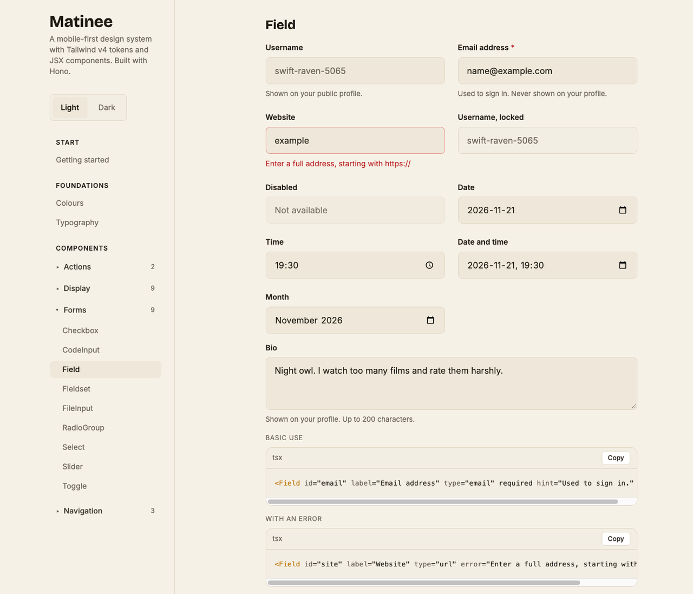

# Matinee

[](https://www.npmjs.com/package/@ayonkhan/matinee)
[](LICENSE)
[](https://github.com/ayonkhan/matinee/releases)

A mobile-first design system for [Hono](https://hono.dev/), with [Tailwind](https://tailwindcss.com/) v4 tokens and JSX components for buttons, forms, cards and navigation, in light and dark. I built it for my own projects, and you can use it too.

You can see every component, with code to copy, in the [docs](https://matinee.ayonkhan.ca/).

<p>
    <picture>
        <source media="(prefers-color-scheme: dark)" srcset="https://raw.githubusercontent.com/ayonkhan/matinee/main/.github/assets/dark.png">
        
    </picture>
</p>

## Contents

- [Features](#features)
- [Requirements](#requirements)
- [Install](#install)
- [Use](#use)
- [What Is Inside](#what-is-inside)
- [Troubleshooting](#troubleshooting)
- [Tests](#tests)
- [Credits](#credits)
- [License](#license)

## Features

- **Mobile-first:** every component is built for small screens first.
- **Light and dark:** one theme with a dark version, switched with a `data-theme` attribute.
- **Server rendered:** the components are plain Hono JSX that render to HTML, and they need no JavaScript.
- **Tailwind v4 tokens:** colours, type and radii are theme tokens, so you use them as classes, such as `bg-page` and `text-ink`.
- **Typed:** written in TypeScript, with the types included.
- **Accessible:** focus rings, labels and ARIA attributes, covered by tests.
- **Tested:** every component has tests.
- **Free:** MIT licensed.

## Requirements

- [Hono](https://hono.dev/) 4
- [Tailwind CSS](https://tailwindcss.com/) 4
- A way to build Tailwind, such as its [Vite plugin](https://tailwindcss.com/docs/installation/using-vite) or its [command line tool](https://tailwindcss.com/docs/installation/tailwind-cli)

## Install

### 1. Add the Package

```bash
pnpm add @ayonkhan/matinee
```

Hono and Tailwind are peer dependencies. If your project doesn't have them yet, add them too:

```bash
pnpm add hono tailwindcss
```

### 2. Load the Theme

Add the theme to your main CSS file:

```css
@import "tailwindcss";
@import "@ayonkhan/matinee/theme.css";
@source "../node_modules/@ayonkhan/matinee/dist";
```

The last line tells Tailwind to look inside Matinee for class names. Without it, the components load with no styles. Change the path if your CSS file lives somewhere else.

### 3. Load the Fonts

The fonts are not bundled. Add these to the head of your page, or host the files yourself:

```html
<link rel="preconnect" href="https://fonts.googleapis.com" />
<link rel="preconnect" href="https://fonts.gstatic.com" crossorigin />
<link
  rel="stylesheet"
  href="https://fonts.googleapis.com/css2?family=Bricolage+Grotesque:opsz,wght@12..96,600;12..96,700&family=Inter:wght@400;500;600&display=swap"
/>
```

### 4. Choose a Theme

Light is the default. For dark, set `data-theme="dark"` on the `html` element. Matinee does not pick for you, so read the choice from a cookie or a setting on the server.

## Use

```tsx
import { Button, Card } from '@ayonkhan/matinee'

export function Welcome() {
  return (
    <Card>
      <p>Welcome back.</p>
      <Button>Continue</Button>
    </Card>
  )
}
```

## What Is Inside

| Group | Components |
| --- | --- |
| Actions | ActionBar, Button |
| Display | Avatar, Badge, Card, CopyBlock, Cover, Disclosure, EmptyState, List, ListItem, Notice, Prose, Stars, Stat |
| Forms | Checkbox, CheckboxGroup, CodeInput, Field, Fieldset, FileInput, RadioGroup, RatingInput, Select, Slider, Toggle |
| Navigation | BottomNav, Footer, Pagination, SegmentedControl, TopBar |

The theme also has tokens for colours, type and radii. The [docs](https://matinee.ayonkhan.ca/) show each one.

## Troubleshooting

**The components have no styles.**
- Check that the `@source` line is in your CSS file, and that its path leads to `node_modules/@ayonkhan/matinee/dist` from where the file lives.
- Check that the CSS file with the theme is the one your page loads.

**The fonts look wrong.** Check that the font links from [step 3](#3-load-the-fonts) are in the head of your page.

**Dark mode doesn't apply.** Check that `data-theme="dark"` is on the `html` element, and not on the body or a wrapper.

## Tests

To work on Matinee itself, clone the repo and run `pnpm install`. Then you can run the tests:

```bash
pnpm test
```

To check the types:

```bash
pnpm typecheck
```

To start the docs site on your machine:

```bash
pnpm dev
```

## Credits

Fonts are Bricolage Grotesque and Inter, under the SIL Open Font License. Built with Hono and Tailwind CSS.

## License

[MIT](LICENSE)
